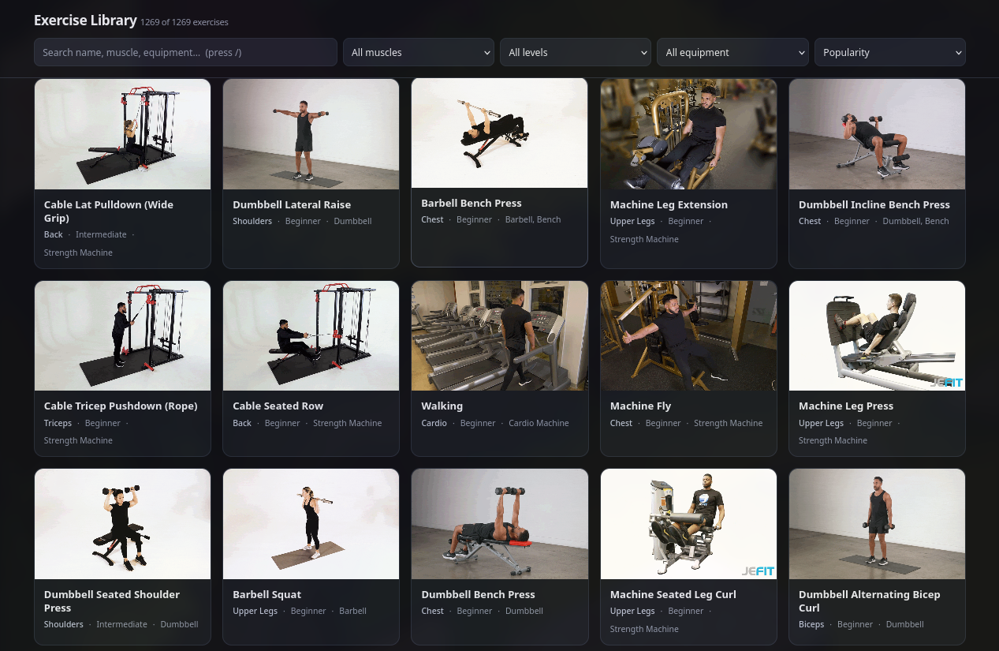

# Exercise Library Dataset

1,269 exercises scraped from [JEFIT](https://www.jefit.com/exercises):
- name
- description
- difficulty
- type
- log type
- equipment
- body parts
- target muscles
- popularity
- one animated gif (1–4 still frames each)



## Contents

```
data/excercises.json      all records (pretty-printed array)
data/exercises.jsonl      same records, one per line
media/<id>/<id>.gif       exercise animation
media/<id>/<imgid>.jpg    960×590 still frames
index.html                offline viewer of all excercises
scrape.py                 scraper that produced the files
```

1,262 gifs, 4,944 images, ~500 MB total. Seven exercises have no gif; the viewer falls back to their first image.

## Record shape

```json
{
  "id": 86,
  "name": "Cable Lat Pulldown (Wide Grip)",
  "url": "https://www.jefit.com/exercises/86/cable-lat-pulldown-wide-grip",
  "description": "…",
  "difficulty": "intermediate",
  "exercise_type": "strength",
  "log_type": "weight_and_reps",
  "popularity": "165484",
  "equipment": ["machine_strength", "none"],
  "body_parts": ["back", "shoulders", "none", "traps", "lats"],
  "muscles": { "main": ["Back"], "secondary": ["Shoulders"] },
  "gif": { "url": "…", "path": "media/86/86.gif" },
  "images": [{ "url": "…", "path": "media/86/344.jpg" }]
}
```

`path` is relative to the repo root. `equipment` keys mirror the site (`machine_strength`, `hex_bar`, …).

## Viewing

Open `index.html` and drag `data/excercises.json` onto the page.

Search, filter by muscle/difficulty/equipment.

Click a card for the full record.

## Notes

- Scraped in 2026 from the public exercise pages; no login, no API.
- Text and media remain JEFIT's property. Treat this as a mirror for personal/research use and credit the source; don't relicense the images as your own.
- `scrape.py` is kept for reproducibility: `python3 scrape.py` re-fetches into `data/exercises.jsonl` and skips records already present.
